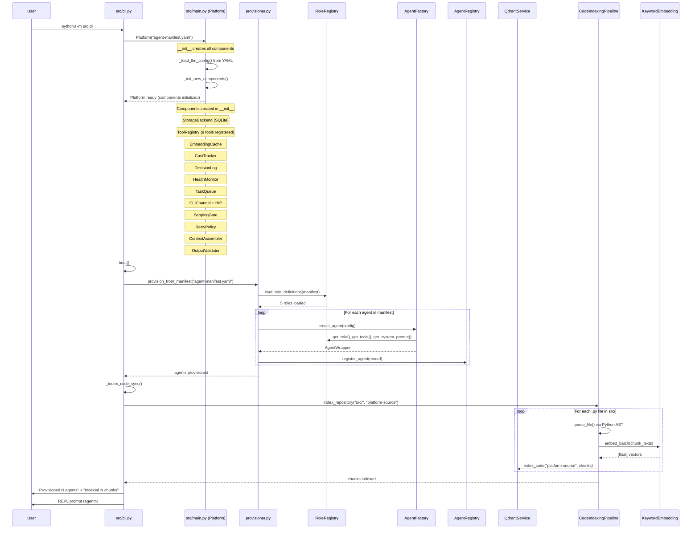
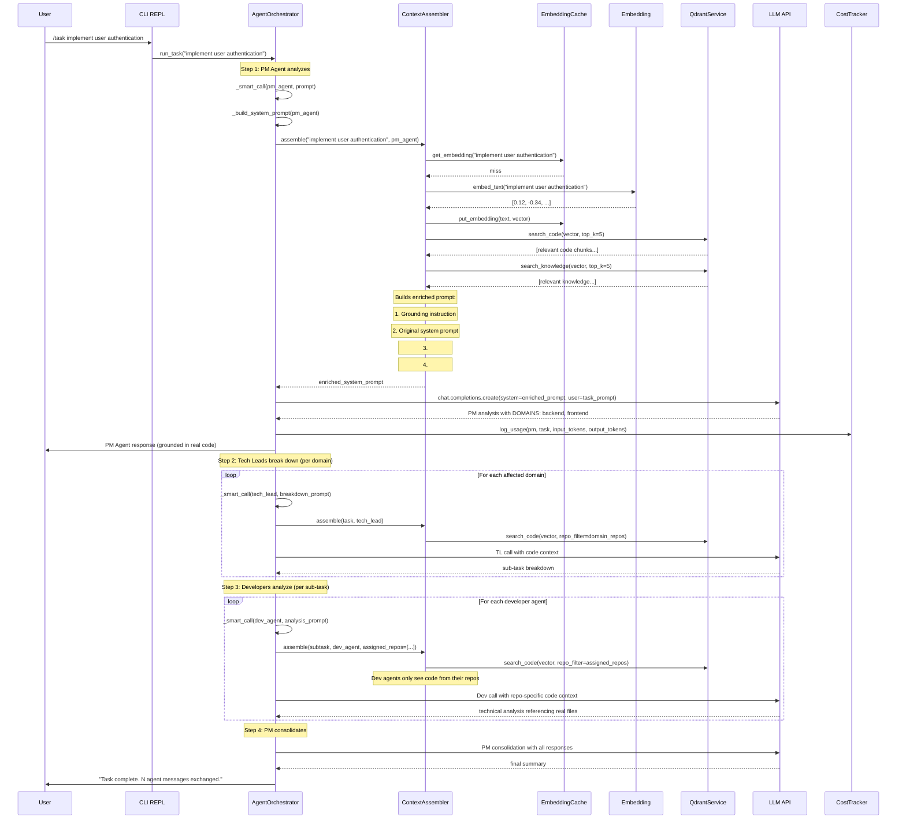
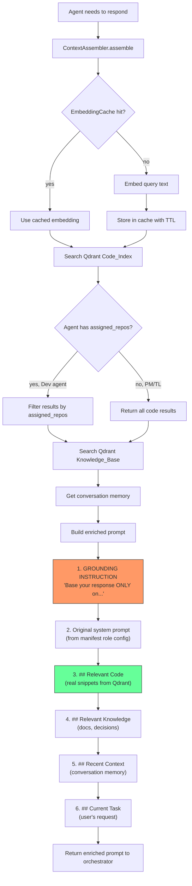
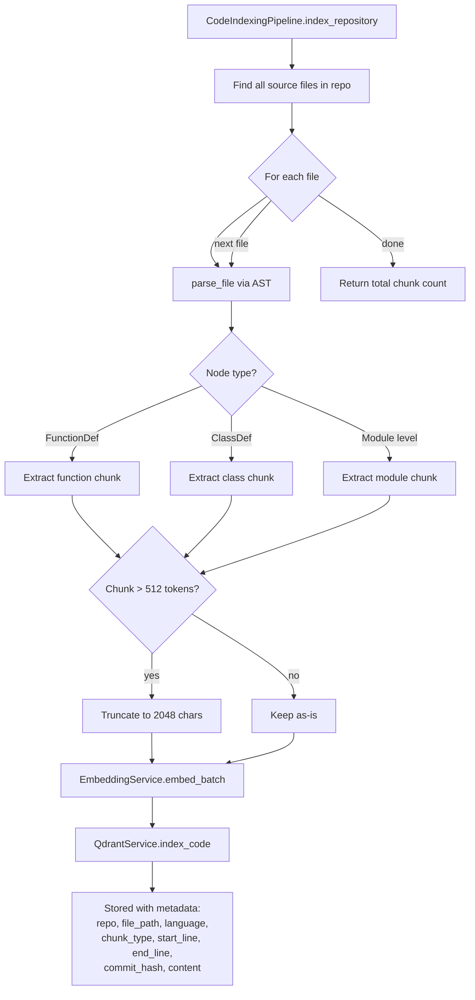

# Multi-Agent Platform — Architecture Flows

## 1. Boot Sequence



## 2. Task Execution Flow (/task command)



## 3. Context Assembly Detail



## 4. Code Indexing Pipeline



## 5. Component Dependency Map

```mermaid
graph TB
    subgraph Entry["Entry Points"]
        CLI["src/cli.py<br/>InteractiveCLI"]
        Main["src/main.py<br/>Platform"]
    end

    subgraph Orchestration["Orchestration"]
        Orch["orchestrator.py<br/>AgentOrchestrator"]
        Factory["factory.py<br/>AgentFactory"]
        CtxAsm["context_assembler.py<br/>ContextAssembler"]
        OutVal["output_validator.py<br/>OutputValidator"]
        ScopeGate["scoping_gate.py<br/>ScopingConfirmationGate"]
        ToolReg["tool_registry.py<br/>ToolRegistry"]
    end

    subgraph CodeOps["Code Operations"]
        LFM["local_file_manager.py<br/>LocalFileManager"]
        Sandbox["sandbox.py<br/>SandboxExecutor"]
        Analyzer["code_analyzer.py<br/>CodeAnalyzer"]
        Rollback["task_rollback.py<br/>TaskRollback"]
    end

    subgraph Knowledge["Knowledge Layer"]
        CodeIdx["code_indexing.py<br/>CodeIndexingPipeline"]
        KnowIdx["knowledge_ingestion.py<br/>KnowledgeIngestionPipeline"]
        EmbCache["embedding_cache.py<br/>EmbeddingCache"]
        Embed["embedding.py<br/>EmbeddingProvider"]
        Qdrant["qdrant_service.py<br/>QdrantService"]
    end

    subgraph Infra["Infrastructure"]
        Storage["storage.py<br/>StorageBackend"]
        AgentReg["agent_registry.py<br/>AgentRegistry"]
        MsgBus["message_bus.py<br/>MessageBus"]
        TaskQ["task_queue.py<br/>TaskQueue"]
        HealthMon["health_monitor.py<br/>AgentHealthMonitor"]
        Channels["channels.py<br/>CLIChannel"]
        HIP["human_interaction.py<br/>HumanInteractionPoint"]
        Notif["notifications.py<br/>ConsoleLogProvider"]
        Retry["retry_policy.py<br/>RetryPolicy"]
        DryRun["dry_run.py<br/>DryRunManager"]
        Approval["approval_gate.py<br/>ApprovalGateService"]
    end

    subgraph Observability["Observability"]
        CostTrk["cost_tracker.py<br/>CostTracker"]
        DecLog["decision_log.py<br/>DecisionLog"]
        PerfMet["performance_metrics.py<br/>AgentPerformanceMetrics"]
        Audit["audit.py<br/>AuditTrail"]
    end

    subgraph Integrations["Integrations"]
        GitHub["github_connector.py<br/>GitHubConnector"]
        DevOps["devops_connector.py<br/>DevOpsConnector"]
        WorkItems["work_items.py<br/>LocalWorkItemProvider"]
        PRReview["pr_review.py<br/>PRReviewService"]
    end

    CLI --> Main
    CLI --> Orch
    Main --> Factory & AgentReg & MsgBus & Qdrant & Audit

    Orch --> CtxAsm & OutVal & CostTrk & Retry & HealthMon & ToolReg
    Orch --> TaskQ & HIP & ScopeGate
    CtxAsm --> Qdrant & Embed & EmbCache
    ToolReg --> Analyzer & LFM & Sandbox & Qdrant

    CodeIdx --> Embed & Qdrant
    KnowIdx --> Embed & Qdrant

    AgentReg & MsgBus & Approval & TaskQ --> Storage
    CostTrk & DecLog & PerfMet --> Storage
    DecLog --> Audit
    HIP --> Channels
    ScopeGate --> HIP
    PRReview --> GitHub

    style CLI fill:#4af,stroke:#333
    style Orch fill:#fa4,stroke:#333
    style CtxAsm fill:#4f4,stroke:#333
    style Qdrant fill:#f4f,stroke:#333
    style Storage fill:#ff4,stroke:#333
```



## 6. Data Flow: Where Knowledge Lives

```
┌─────────────────────────────────────────────────────────────┐
│                    QdrantService (in-memory)                 │
│                                                              │
│  ┌──────────────────┐  ┌──────────────────┐  ┌───────────┐ │
│  │   Code_Index     │  │  Knowledge_Base  │  │ Conv_Mem  │ │
│  │                  │  │                  │  │           │ │
│  │ Chunks from      │  │ Ingested docs    │  │ Agent     │ │
│  │ src/*.py         │  │ (.md, .txt, etc) │  │ convo     │ │
│  │                  │  │                  │  │ history   │ │
│  │ Each chunk has:  │  │ Each chunk has:  │  │           │ │
│  │ - repo name      │  │ - source_file    │  │ - agent_id│ │
│  │ - file_path      │  │ - content        │  │ - content │ │
│  │ - chunk_type     │  │ - format         │  │ - tags    │ │
│  │ - content        │  │                  │  │           │ │
│  │ - embedding vec  │  │                  │  │           │ │
│  │ - start/end line │  │                  │  │           │ │
│  └──────────────────┘  └──────────────────┘  └───────────┘ │
└─────────────────────────────────────────────────────────────┘

┌─────────────────────────────────────────────────────────────┐
│              StorageBackend (SQLite / Filesystem)            │
│                                                              │
│  Collections:                                                │
│  - agents/        → AgentRegistry persistence                │
│  - messages/      → MessageBus durable history               │
│  - approvals/     → ApprovalGate requests                    │
│  - threads/       → DiscussionThread persistence             │
│  - tasks/         → TaskQueue state                          │
│  - cost_records/  → CostTracker token usage                  │
│  - decisions/     → DecisionLog entries                      │
│  - heartbeats/    → HealthMonitor state                      │
│  - hip_records/   → HumanInteractionPoint records            │
│  - task_outcomes/ → PerformanceMetrics                       │
│  - task_conversations/ → Orchestrator conversation history   │
└─────────────────────────────────────────────────────────────┘
```

## 7. Agent Hierarchy (Example)

```
PM Agent (pm-001)
├── Coordinates all domains
├── Analyzes tasks, routes to Tech Leads
├── Consolidates final summaries
│
├── Tech Lead Backend (tl-backend-001)
│   ├── Breaks down backend domain tasks
│   ├── Dev: user-service (dev-user-001)
│   ├── Dev: order-service (dev-order-001)
│   └── Dev: payment-service (dev-payment-001)
│
├── Tech Lead Frontend (tl-frontend-001)
│   ├── Breaks down frontend domain tasks
│   ├── Dev: web-app (dev-webapp-001)
│   └── Dev: mobile-app (dev-mobile-001)
│
├── DB Admin (dba-001)
│   └── Schema analysis, migrations, query optimization
│
└── Staff Engineer (staff-eng-001)
    └── Cross-domain architecture decisions
```
